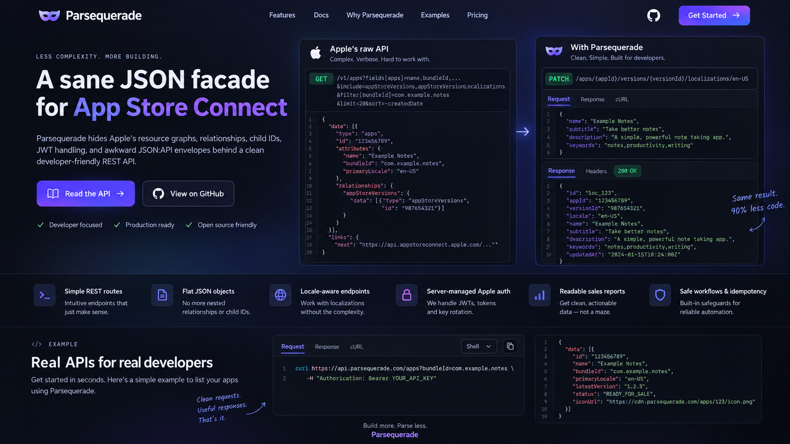

# Parsequerade

Parsequerade simplifies App Store Connect into flat JSON and predictable resource operations. **The [Rust](sdks/rust/README.md), [TypeScript](sdks/typescript/README.md), [Python](sdks/python/README.md), and [Swift](sdks/swift/README.md) SDKs are the recommended way to use it.** They run the facade inside your program and send requests directly to Apple, handling JWT signing, resource lookup, and response translation locally.

The hosted REST API at [parsequerade.mainbrella.com](https://parsequerade.mainbrella.com) is also available, but its extra network hop adds latency and can make it noticeably slower. Hosted requests travel from your app through Cloudflare to Apple; SDK requests go straight from your app to Apple. Use an SDK for application integrations, especially when latency matters. The hosted API remains useful for `curl`, quick experiments, or clients that need a remote REST service.

The goal is to let a client list apps, edit a localized description, update a review contact, or read sales data without implementing Apple JWT signing, looking up internal child IDs, or assembling relationship payloads.

**Status:** All four SDKs and the hosted API support 12 reads for apps, app infos, versions, their localization collections and exact locales, age ratings, and review contacts, plus the scoped age-rating update. The Worker also supports hosted connection onboarding and revocation. Other writes, reports, copy workflows, and broader reads remain planned. See [rest.md](rest.md) for the remaining milestones.

## Start with an SDK (recommended)

The [Rust](sdks/rust/README.md), [TypeScript](sdks/typescript/README.md), [Python](sdks/python/README.md), and [Swift](sdks/swift/README.md) SDKs implement the same 12 reads and age-rating update inside your program. They send requests directly to Apple, removing the Cloudflare proxy hop while retaining flat resources, facade query names, exact-locale lookup, ownership checks, pagination, and stable errors. JWT signing and caching happen locally with your Apple team key; no hosted connection or facade API key is needed.

The Rust crate at `sdks/rust` can be used as a Cargo path dependency. The Node.js 22+ ESM package at `sdks/typescript` is named `@parsequerade/sdk` and bundles the Worker's facade code without runtime dependencies. The Python 3.11+ package at `sdks/python` uses `cryptography` for signing and standard-library HTTPS. The Swift 5.9+ package at `sdks/swift` uses Foundation and CryptoKit on Apple platforms, with no external dependencies. All four SDKs generate models from the same reviewed contracts. See their READMEs and runnable examples for installation, authentication, and pagination. None is published to its package registry yet. Scoped operations can still require multiple Apple calls to resolve and verify their targets.

## Use the hosted API (optional)

This is the slower, proxied path: your app → Cloudflare → Apple. Choose it when a remote REST endpoint is useful enough to accept the added latency. SDK users can skip this section and the Worker deployment setup; they only need their Apple team key and the SDK's installation instructions.

When the Worker is deployed with its hosted-connection bindings and encryption secret, you can connect an App Store Connect team key with `curl` and receive a read-only facade key for the apps that Apple key can access. Hosted setup requires a Cloudflare Durable Object binding/migration and a stable `CONNECTION_ENCRYPTION_KEY`; see deployment setup below.

Create an App Store Connect API key at [Users and Access → Integrations → Team Keys](https://appstoreconnect.apple.com/access/integrations/api). Copy the **Issuer ID** and **Key ID**, then download the `.p8` private key file (Apple only lets you download it once). Keep that file private. The optional vendor number is only needed for sales reports, which are not implemented in this read-only slice.

`POST /v1/connections` accepts a JSON body of at most 8 KiB with `issuerId`, `keyId`, and `privateKey`, and optional `capabilities`; `privateKey` is the PKCS#8 PEM contents, not a file path. The Worker validates the P-256 key locally, then makes a read-only `GET /v1/apps?limit=1` probe against Apple. Success returns `201 Created` with a generated connection ID (`conn_live_` plus 32 hex characters), a connection `baseUrl`, and a facade key (`pq_` plus a random 32-byte base64url value). The reserved `conn_live_` prefix is used for generated hosted IDs. The key defaults to read-only access to all apps the supplied Apple key can access. Set `capabilities: ["read", "write"]` at creation to enable the age-rating POST; the list must include read and may only contain read and write. Existing connections stay read-only and must reconnect explicitly for write access. The setup probe checks read access; Apple checks write permission on each update. You do not need a preissued facade key or a Cloudflare account. The Worker stores the Apple credential encrypted and only a SHA-256 hash of the facade key; API responses are `no-store` and logs redact secrets. Treat both the submitted Apple key and returned bearer key as secrets.

Use `curl` and `jq`. The response is saved in a private temporary file outside the checkout:

```sh
P8_FILE="$HOME/Downloads/AuthKey_ABC123DEFG.p8"
ISSUER_ID='YOUR_ISSUER_UUID'
KEY_ID='YOUR_KEY_ID'
CONNECTION_FILE="$(mktemp "${TMPDIR:-/tmp}/parsequerade-connection.XXXXXX")"

jq -n --arg issuerId "$ISSUER_ID" --arg keyId "$KEY_ID" \
  --rawfile privateKey "$P8_FILE" \
  '{issuerId: $issuerId, keyId: $keyId, privateKey: $privateKey}' |
  curl --fail-with-body --silent --show-error \
    -X POST 'https://parsequerade.mainbrella.com/v1/connections' \
    -H 'Content-Type: application/json' --data-binary @- > "$CONNECTION_FILE"

# Example response (values are fictional):
# {"connectionId":"conn_live_0123456789abcdef0123456789abcdef","baseUrl":"https://parsequerade.mainbrella.com/v1/connections/conn_live_0123456789abcdef0123456789abcdef","apiKey":"pq_example_random_base64url_key"}

BASE="$(jq -er '.baseUrl' "$CONNECTION_FILE")"
ASC_FACADE_KEY="$(jq -er '.apiKey' "$CONNECTION_FILE")"

curl --fail-with-body "$BASE/apps?limit=50" \
  -H "Authorization: Bearer $ASC_FACADE_KEY"

# Optional: read one app using an ID from the list response.
curl --fail-with-body "$BASE/apps/1234567890" \
  -H "Authorization: Bearer $ASC_FACADE_KEY"
```

When finished, the authenticated `DELETE /v1/connections/{connectionId}` endpoint removes the stored credentials and revokes that facade key, returning `204 No Content`:

```sh
curl --fail-with-body -X DELETE "$BASE" \
  -H "Authorization: Bearer $ASC_FACADE_KEY"
rm -- "$CONNECTION_FILE"
unset ASC_FACADE_KEY
```

Revoke the Apple team key separately in App Store Connect if you created it only for this trial.

## Self-host or develop locally

Use Node.js 22 or newer and Python 3. Install dependencies with `npm ci`, then configure an Apple team key and the app IDs this client may read:

```sh
npm run configure -- \
  --connection conn_main \
  --issuer-id YOUR_ISSUER_UUID \
  --key-id YOUR_KEY_ID \
  --private-key /path/to/AuthKey.p8 \
  --app-id YOUR_APP_ID

npm run dev
```

Repeat `--app-id` for multiple apps, or explicitly use `--all-apps`. Setup validates a P-256 PKCS#8 key locally and generates three private, gitignored files with mode `0600`:

- `.dev.vars`: local Worker configuration and secrets, loaded by Wrangler.
- `.parsequerade.secrets.json`: the same configuration for deployment.
- `.parsequerade-client-key`: the newly issued facade bearer key. The Worker configuration contains only its SHA-256 hash.

The command refuses to overwrite existing files and makes no network requests. Set `ASC_FACADE_KEY` from the client-key file, then read an app:

```sh
ASC_FACADE_KEY="$(cat .parsequerade-client-key)"
BASE='http://localhost:8787/v1/connections/conn_main'

curl --fail-with-body "$BASE/apps?limit=50" \
  -H "Authorization: Bearer $ASC_FACADE_KEY"
```

For operator deployment, update the custom domain in `wrangler.jsonc`, authenticate Wrangler to your Cloudflare account, run `npm run check`, then run:

```sh
npm run deploy -- --secrets-file .parsequerade.secrets.json
```

The Worker serves `/` and `/docs/` as static assets and sends `/v1/*` to `worker/index.js`. Hosted API requests require HTTPS; local development binds to `127.0.0.1` and permits loopback HTTP. API data and errors use `Cache-Control: private, no-store`; private configuration belongs outside `dist/`. Missing operator configuration returns `503 service_not_configured`; missing hosted-connection storage or encryption configuration returns `503 hosted_connections_not_configured`, while the static site remains available.

Configuration consists of `APPLE_CONNECTIONS_JSON` (connection ID → issuer ID, key ID, credential revision, and private-key secret name), separately named `APPLE_PRIVATE_KEY` or `APPLE_PRIVATE_KEY_*` secrets, `FACADE_API_KEYS_JSON` (key IDs, hashes, and per-connection capability/app grants), and a 32-byte base64url `CURSOR_SIGNING_KEY`. The generated JSON file is an editable example. Grants accept `appIds: "*"` or an explicit list of up to 200 app IDs; an empty list grants no apps. All four values are deployed as Worker secrets.

Revoke an operator-configured facade key by removing its record or setting `revoked: true`, then publish the updated secrets. Hosted connections are instead revoked with the authenticated DELETE endpoint. To rotate an Apple key, update its issuer/key ID and private-key secret and increment `credentialRevision`; this invalidates cached JWTs and old cursors. Rotating `CURSOR_SIGNING_KEY` also invalidates existing cursors. The setup helper provisions one operator-configured connection and client; additional connections and grants can be added explicitly to the configuration.

### Hosted connection deployment

Hosted onboarding needs the `HOSTED_CONNECTIONS` SQLite Durable Object binding and migrations in `wrangler.jsonc`, the `CONNECTION_SETUP_LIMITER` binding (10 setup attempts per minute per IP and Cloudflare location), and a stable 32-byte base64url `CONNECTION_ENCRYPTION_KEY` Worker secret. Generate a private secrets file and deploy it with the Worker:

```sh
umask 077
node -e "require('node:fs').writeFileSync('.parsequerade-hosted.secrets.json', JSON.stringify({CONNECTION_ENCRYPTION_KEY: require('node:crypto').randomBytes(32).toString('base64url')}), {flag: 'wx', mode: 0o600})"
npm run deploy -- --secrets-file .parsequerade-hosted.secrets.json
```

Keep that key stable: deleting or rotating it without migrating stored records makes existing Apple credentials unreadable. For local Wrangler development, put `CONNECTION_ENCRYPTION_KEY` in `.dev.vars`.

Resource routes accept GET; the age-rating resource also accepts the scoped POST documented below. Other mutation methods return `405`; planned routes return JSON `404 route_not_found`. Public connection creation and authenticated deletion are supported; there is no arbitrary upstream URL proxy. Permission checks happen before resource reads, and app-scoped list requests constrain Apple's `filter[id]` rather than filtering an unbounded account crawl.

Each facade request permits 25 seconds and 32 Apple attempts, with an 8-second attempt timeout, 4 MiB response limit, and 16 MiB total body limit. Safe reads retry up to twice within that budget, respect short `Retry-After` delays, and refresh a rejected cached JWT at most once. A long throttle delay is returned to the caller. Locale/ownership resolvers permit 20 pages. Cursors expire after 15 minutes, permit 100 pages, and bind the caller/key grant, Apple credential revision, path, filters, fields, ordering, and limit. Concurrency is bounded to four Apple reads per connection **within each isolate**; shared connection-wide coordination is deferred to the Durable Object phase. No private resource cache is used in this slice.

### Scoped age-rating update

`POST /v1/connections/{connectionId}/apps/{appId}/app-infos/{appInfoId}/age-rating` is the first resource write. Send a nonempty flat object of age-rating attributes as `application/json` (8 KiB maximum), for example `{"gambling": false, "ageRatingOverrideV2": "NONE"}`. No query parameters, identifiers, or relationship envelopes are accepted. Both read and write grants and access to the target app are required; read-only grants receive `403 write_forbidden` before any Apple requests.

The Worker proves the target app-info belongs to the app, reads its declaration ID, and sends one `PATCH /v1/ageRatingDeclarations/{id}`. Only submitted attributes change. Success is `200` with the same flattened declaration as GET. The exact allowlist, enums, and nullable fields are documented in [OpenAPI](dist/docs/openapi.json) and [API conventions](https://parsequerade.mainbrella.com/docs/conventions/#age-rating-updates). Questionnaire nulls are rejected; omit unanswered fields. Optional overrides/text can be null to clear. Deprecated `ageRatingOverride` is unsupported. Strings are limited to 2,048 characters and URLs must use HTTP(S) without embedded credentials. Apple validates key roles, app state, and answer combinations.

Writes are never retried, even after Apple authentication/rate-limit errors or an uncertain network outcome, and write failures are marked `retryable: false`. Uncertain network, timeout, or malformed success outcomes use `write_outcome_unknown`. Read back the target before deciding whether to try another POST.

## Verify

`npm run check` validates documentation, generated runtime/OpenAPI contracts, and JavaScript, then runs unit/security tests and the bundled Worker in local `workerd` via Miniflare. Tests use fictional fixtures and generated test keys; all outbound Apple requests are mocked. The deployment build uses `--dry-run`, so checks do not publish anything. Real-account verification is a separate, explicitly configured read-only check.

`npm run check` also builds and tests the TypeScript package, including its public types. With Rust, Swift, and the Python SDK installed in your active Python environment, `npm run check:sdks` checks all four SDKs, Rust formatting, and Clippy. SDK tests use mocked Apple responses and generated test keys. Run `npm run build:sdks` after updating facade contracts to regenerate all SDK models and contracts, build the TypeScript bundle and Python wheel, and compile Swift. This requires Swift and Python with pip in addition to Node.js. Individual `build:sdk:*` commands build a single package. Installed SDKs are self-contained; only the Python SDK requires a Python runtime, and none needs Worker source.

## Documentation site

The static site lives in `dist/`; `/` is the Parsequerade landing page and the documentation starts at `/docs/`. Run `npm install` once, then use `npm run dev` to preview it locally. `npm run deploy` publishes through the existing Wrangler configuration.

The GET reference covers all **457 GET endpoint pages** reached through Apple’s [App Store documentation topic tree](https://developer.apple.com/documentation/appstoreconnectapi/app-store), organized into 84 topics. Pages identify implementation status separately from delivery stage; documentation coverage is broader than runtime coverage. Additional resource reads are extended designs, and older resource shapes have separate proposed `/legacy` routes. The [facade OpenAPI document](dist/docs/openapi.json) covers the 12 implemented read routes, the scoped age-rating POST, and hosted connection creation and deletion.

- `npm run build:docs` exports `api/read-contracts.json` and the facade OpenAPI document, then regenerates the reference and guides offline from the reviewed Apple snapshot, facade mappings, editorial overrides, and guide sources. `api/read-routes.json` explicitly selects implemented adapters.
- `npm run check` verifies local links, endpoint coverage, examples, contract drift, syntax, API behavior, and local Worker execution. Miniflare is a test-only dependency; the Worker adds no runtime packages.
- `npm run sync:docs` explicitly downloads Apple’s current topic pages and OpenAPI specification and replaces the source snapshot. Review source changes before rebuilding. The current snapshot records OpenAPI 4.5.1 and the source checksums; ordinary builds make no network requests.

## Why a facade?

Apple already provides a REST API that returns JSON. The difficulty is its resource and relationship model. For example, even Apple's [List apps endpoint](https://developer.apple.com/documentation/appstoreconnectapi/get-v1-apps) asks readers to understand query parameters such as `fields[apps]`, which can mix ordinary app attributes with related resources. The reference makes routine app-listing tasks harder to discover because readers must first learn Apple's resource graph; it does not mean every listed field is required or that every resource can be changed.

**Before: Apple's API documentation**

![Apple's List apps API documentation showing the long fields[apps] parameter list of app attributes and related resources.](docs/images/app-store-connect-api-docs.png)

**After: Parsequerade concept**



An app's metadata also spans several resources. App names and privacy URLs belong to app-info localizations. Descriptions and release notes belong to version localizations. A review contact is another resource associated with a version. Editing one field can require finding the right parent, following a relationship, resolving a child ID, and then constructing a typed update body.

Parsequerade handles that translation inside your SDK or the hosted Worker. Clients work with app IDs, explicit app-info or version IDs, locale strings, and ordinary JSON fields.

The planned shape has some overlap with [applelink](https://github.com/tramlinehq/applelink), which already offers flat JSON and multi-request release recipes. Parsequerade's design focuses on server-owned Apple credentials, explicit resource targets, and durable plans and results that callers can inspect.

## Before and after

These examples use fictional values and show only selected fields.

### List apps

Apple request:

```http
GET https://api.appstoreconnect.apple.com/v1/apps?filter[bundleId]=com.example.notes
```

Apple response shape:

```json
{
  "data": [
    {
      "type": "apps",
      "id": "1234567890",
      "attributes": {
        "name": "Example Notes",
        "bundleId": "com.example.notes",
        "primaryLocale": "en-US"
      },
      "relationships": {
        "appStoreVersions": {
          "links": {
            "related": "https://api.appstoreconnect.apple.com/v1/apps/1234567890/appStoreVersions"
          }
        }
      }
    }
  ]
}
```

Proposed Parsequerade request, relative to a configured connection:

```http
GET /apps?bundleId=com.example.notes
```

Proposed response:

```json
{
  "items": [
    {
      "id": "1234567890",
      "name": "Example Notes",
      "bundleId": "com.example.notes",
      "primaryLocale": "en-US"
    }
  ],
  "nextCursor": null
}
```

The client can read `response.items[0].name` directly. Single-resource reads return a plain object; collections use `items` and `nextCursor`.

### Edit a localized description

First, list versions with `GET /apps/{appId}/versions` and choose the intended version. Then address its locale directly:

```sh
BASE='https://parsequerade.mainbrella.com/v1/connections/conn_example'

curl -X PATCH "$BASE/apps/1234567890/versions/version_123/localizations/en-US" \
  -H "Authorization: Bearer $ASC_FACADE_KEY" \
  -H 'Content-Type: application/json' \
  -H 'Idempotency-Key: description-change-001' \
  -d '{"description":"Keep your notes organized.","supportUrl":"https://example.com/support"}'
```

This proposed write route is not implemented yet. The service would resolve `en-US` to the Apple localization ID, check its ownership, and send Apple's required payload internally:

```json
{
  "data": {
    "type": "appStoreVersionLocalizations",
    "id": "localization_456",
    "attributes": {
      "description": "Keep your notes organized.",
      "supportUrl": "https://example.com/support"
    }
  }
}
```

Clients would receive the updated flat localization object. A missing locale returns `404 localization_not_found`; creating a locale is an explicit `POST`.

## The proposed API

Each configured Apple connection has a base URL:

```text
https://parsequerade.mainbrella.com/v1/connections/{connectionId}
```

Requests use a facade API key. The service owns the configured Apple credentials and JWT lifecycle, and checks the caller's permissions for each connection and resource.

Routes below are relative to that base. This is a summary; [rest.md](rest.md#resource-routes) defines the full planned contract and delivery stages.

| Task | Proposed route |
| --- | --- |
| List or read apps | `GET /apps`, `GET /apps/{appId}` |
| Select app information | `GET /apps/{appId}/app-infos` |
| Read or edit an app-level locale | `GET`, `PATCH /apps/{appId}/app-infos/{appInfoId}/localizations/{locale}` |
| Select a version | `GET /apps/{appId}/versions?platform=IOS&state=PREPARE_FOR_SUBMISSION` |
| Read or edit a version-level locale | `GET`, `PATCH /apps/{appId}/versions/{versionId}/localizations/{locale}` |
| Read, create, or edit a review contact | `GET`, `POST`, `PATCH /apps/{appId}/versions/{versionId}/review-contact` |
| Read sales as JSON | `GET /sales-reports?frequency=monthly&period=2026-09&vendorNumber=12345678` |
| Preview a metadata copy | `POST /copy-plans` |
| Execute a previewed copy | `POST /copy-plans/{planId}/executions` |
| Inspect workflow progress | `GET /operations/{operationId}` |

Writes start with the specific fields listed in the plan. Reading a field does not make it writable. Uploads, submission, pricing, and broader TestFlight management need separate contract work.

## What the facade handles

- **Resource translation.** Flatten `attributes`, build Apple's typed request envelopes, and translate supported relationship edits. For example, `{"primaryCategoryId":"UTILITIES"}` becomes a category relationship update.
- **Target selection.** Resolve localization and review-contact IDs internally. Require explicit app-info and version targets for writes; never silently pick the first version or substitute another locale.
- **Pagination.** Return bounded pages with opaque cursors. Clients pass `cursor` back to the facade instead of following Apple pagination URLs. Incomplete upstream traversal is an error.
- **Updates and errors.** Omitted PATCH fields stay unchanged. Clearing with `null` is allowed only for supported fields. Preserve valid empty strings, `false`, and `0`; reject unsupported fields. Return stable error codes and field-level details.
- **Sales decoding.** Download and decode Apple's compressed tabular reports into typed JSON rows. Preserve monetary precision as decimal strings and keep currencies separate. An unavailable report is an error, rather than zero sales.
- **Write tracking.** Require idempotency keys and record write attempts. If a dispatched write times out, expose its uncertain outcome for reconciliation instead of blindly repeating it.
- **Copy workflows.** Preview selected metadata changes before execution, then expose progress and per-step outcomes. Multi-request copies can partially succeed; cancellation does not undo completed writes.

Apple's permissions, validation rules, and editable states still apply. The facade gives clients a consistent way to address resources and inspect outcomes while handling Apple's authentication and graph traversal in the SDK or hosted Worker. Report parsing remains planned.

## Plan

The SDKs are the main integration path. They preserve the facade while avoiding the hosted proxy hop; the hosted API remains an optional way to access it over REST.

The hosted self-service flow lets each user supply an Apple team key and receive a facade key scoped to that connection, read-only unless write access is explicitly requested. The Worker stores hosted credentials encrypted and supports authenticated connection deletion. Operator configuration remains supported. Reads return data without changing Apple resources.

Writes should name the app, platform, version or app-info resource, and locale they target. The existing `POST /copy-plans` contract previews a selected metadata copy field by field, stores the resolved targets and proposed steps, and performs no Apple writes. Applying that stored plan revalidates it and executes only its approved steps. This preview/apply contract is currently specified for copies in [rest.md](rest.md#6-copying-metadata-is-a-workflow); previewing arbitrary supplied multi-locale changes is a possible extension whose request and response contract still needs to be designed there.

Execution records would persist each step's confirmed success, failure, or unknown outcome when a request may have reached Apple but its result cannot be confirmed. The overall result would distinguish partial success from a completed workflow. After a restart, dispatched steps must be reconciled before retrying, so callers can inspect what completed without treating a multi-request workflow as a transaction.
